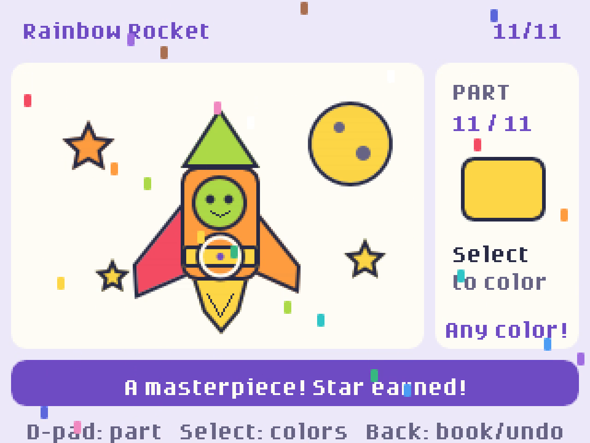
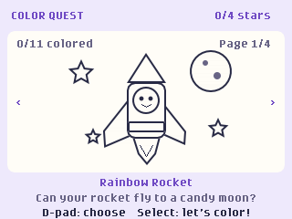
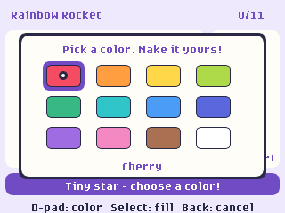

# Color Quest 🎨

A kid-friendly, offline coloring game for the **GitHub Universe 2026 badge**, inspired by [pierceboggan/coloring-book](https://github.com/pierceboggan/coloring-book).

Use the D-pad to pick a part of the drawing, press **Select** to open the color palette, choose a color, and press **Select** again to fill it in. Finish a page to earn a star and confetti! 

Four original pages: **Rainbow Rocket**, **Dino Picnic**, **Bubble Buddies**, and **Party Bot**.


## See it in action

[](https://github.com/jamesmontemagno/color-quest-badge/blob/main/docs/media/color-quest-promo.mp4)

**[Watch the 40-second promo](https://github.com/jamesmontemagno/color-quest-badge/blob/main/docs/media/color-quest-promo.mp4)** · [Download the MP4](https://github.com/jamesmontemagno/color-quest-badge/raw/refs/heads/main/docs/media/color-quest-promo.mp4)

Recorded in the badge simulator: browse the coloring book, pick colors, and finish the Rainbow Rocket to earn a star and confetti. Cursor jumps between parts are scripted for the demo.

## Screenshots

| Choose a picture | Pick a color |
| --- | --- |
|  |  |

*Simulator captures. Any color is the right color!*

## Controls

| Button | Action |
| --- | --- |
| D-pad | Choose a page / part / color |
| Select | Start page, open colors, fill |
| Back | Cancel, or open the toolbox (pages, undo) |

Artwork is saved on the badge, so kids can come back to their pictures.

## Install on your badge

1. Put the badge in USB Disk Mode (open the **Mass Storage** app, double-tap RESET, or run
   `mpremote connect <port> exec "import powman; powman.reset_into_msc()"`).
2. Copy `badge/apps/color_quest` to `BADGER/apps/color_quest`.
3. Eject the drive; the badge restarts into the menu.

You can also try it in the [badge simulator](https://badger.github.io/editor).

See [badge/apps/color_quest/README.md](badge/apps/color_quest/README.md) for full play notes.

## Development

```powershell
python -m unittest tests.test_color_quest   # host-side tests
python tools/build_color_quest_icon.py      # rebuild the 24x24 icon (needs Pillow)
```

## License

MIT
